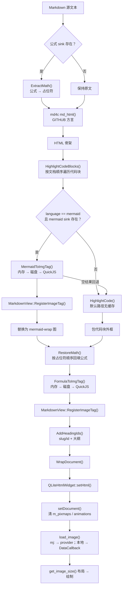
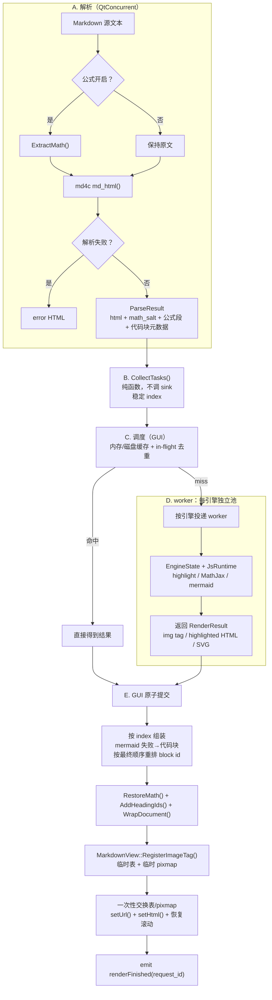

# Markdown 多线程渲染 LaTeX 和 Mermaid 设计

## 一、总体流程

### 1.1 当前流程（同步）



当前流程要点：

- `MarkdownToHtml()` 同步顺序：`ExtractMath()` → `md_html()` →
  `HighlightCodeBlocks()` → `RestoreMath()` → `AddHeadingIds()`；
  `MarkdownView` 之后 `WrapDocument()`、`setUrl()`、`setHtml()`。
- Mermaid 在 `HighlightCodeBlocks()` 的代码块循环里处理；失败才退回普通代码块。
- `HighlightCode()` 默认路径没有缓存；只对非空代码块调用。公式/Mermaid 有
  “内存 → 磁盘 → QuickJS”三级路径。
- 公式/Mermaid 结果先经 `MarkdownView::RegisterImageTag()` 进 token/QPixmap
  缓存，再进 HTML；provider 只读 `document_pixmaps_`。
- `setHtml()` 之后 qlitehtml 还会 `setDocument()`、逐张 `load_image()`、
  `get_image_size()` 布局、绘制。

### 1.2 新设计（只保留异步路径）



设计要点：

- **不保留同步渲染路径**。`MarkdownView` 只走异步；`HighlightCode()` /
  `FormulaToImgTag()` / `MermaidToImgTag()` 的同步公开入口删除，测试改走
  `renderFinished`。旧同步 `MarkdownToHtml()` 只留在测试里作参考实现。
- **拆成三段**：`ParseMarkdown()`（`ExtractMath` + `md_html`，纯 CPU）、
  `CollectTasks()`（纯函数，只收集任务，不调用 sink）、`Assemble()`（GUI）。
- **任务带稳定 index**：代码块、公式段、Mermaid 都按原文档顺序编号；组装按
  index 回填，不按完成顺序。
- **Mermaid 失败回退**：`CollectTasks()` 为每个 mermaid 块同时产生 fallback
  highlight 任务（推测执行）；成功输出 `mermaid-wrap` 并丢弃高亮结果，失败
  输出代码块外框与高亮结果。`block_index` 在最终文档顺序上重新编号，再填
  `code_blocks_`。
- **自定义高亮不支持**：`options.highlight` 是 GUI lambda，异步路径无法在
  worker 调；`MarkdownView` 不再设置它，默认高亮作为 worker 任务。若宿主设置
  自定义回调，明确报不支持，不静默退回同步。
- **首屏**：所有任务完成后一次 `setHtml()`；首屏时间等于最慢任务。渐进首屏
  依赖图片懒加载的 0007 补丁，不在本期。
- **异步契约**：`LoadFile()`/`SetContent()` 返回“已派发”，提交完成发
  `renderFinished(request_id)`；测试用 `QSignalSpy`/`QTRY_VERIFY` 等待。

## 二、线程与引擎模型

### 2.1 引擎状态与生命周期

- 一个 `JsRuntime` 只装一个引擎；**按引擎分池**（highlight / formula /
  mermaid 各自 1..N 个 worker），避免每个 worker 加载全部引擎。
- 每个 worker 一份 `EngineState`：
  `JsRuntime` + `highlight_fn` + `mermaid_initialized` + `render_settled` +
  `font_family` + 首次加载/失败标志。C 回调用
  `JS_SetRuntimeOpaque()`/`JS_GetRuntimeOpaque()` 取当前 state。
- 删除文件级全局：`g_engine`、`g_highlight_fn`、`g_initialized`、
  `g_render_settled`。`EvalGlobal()`/`EnsureLoaded()`/泵循环全部改为显式
  `EngineState&` 参数。
- **没有同步入口**：公共同步渲染函数删除；所有渲染只经 `RenderService` 异步
  提交。渲染函数拆成引擎层 `Render*OnEngine(EngineState&, snapshot)`（只跑
  JS/SVG/PNG）和调度层（缓存/统计在 GUI）。
- `JsRuntime` 不是 `QObject`；由 worker 持有，`moveToThread()` 后在线程内
  `Initialize()` 里 `EnsureLoaded()`。不要在 GUI 线程预建 runtime。
- 进程级共享池：由模块级 `RenderService : QObject` 持有，首次使用时创建；
  任务带 `(view_id, request_id)`，视图析构只取消自己的请求。
- `RenderService` 在 `aboutToQuit` 和析构里都执行关闭（测试不跑事件循环）：
  取消所有请求、武装 interrupt、投递退出、`quit()` + 有界 `wait()`；不得
  `terminate()`。超时记录日志并允许进程退出（有意泄漏）。
- `EngineState`/`JsRuntime` 必须在 worker 线程内释放：`QThread::finished` →
  `deleteLater`，或 worker 线程内的 `Shutdown()` 先释放再退出。
- `JsRuntime` 增加 `ResetForReload()`：释放 context/runtime、清
  `load_failed_`/`load_attempted_`，供“加载中取消”后重新加载；与最终
  `Shutdown()` 分开。
- worker 栈：`QThread::setStackSize(32MB)` 在 `start()` 前调用；Linux 必须，
  Windows 需实测。`JS_NewRuntime` 记录创建线程栈顶，加载必须在 worker 线程
  执行。池大小要计 32MB/worker 的虚拟地址，x86 设上限。
- 引擎配置放进程级 `RenderEngineConfig`（`RenderService` 持有）：
  `JS_SetMemoryLimit` 默认值、worker 数、栈大小；不设内存上限要写明理由。

### 2.2 缓存与静态状态

- 调度线程（GUI）独占 `MarkdownRenderContextState`：`formula_cache`、
  `mermaid_cache`、新增 `highlight_cache`、`image_stats` 等。worker 不碰。
- 高亮缓存接入现有 options：新增 `highlight_cache_entries`；`SetOptions()`
  更新上限并 `Trim()`；`ClearMemoryCaches()` 一并清；命中/渲染写入
  `highlight_stats`。
- `pixmap_cache`、`document_pixmaps_` 含 `QPixmap`，只能 GUI 线程读写。
- 所有 `MakeRenderCacheKey()`/`LoadRenderCacheEntry()`/
  `StoreRenderCacheEntry()` 调用留在调度线程。
- 渲染路径上的函数级 static：
  - `mermaid_svg_cleanup.cpp` 的 `pattern_cache`：每 worker 一份，或启动时
    预计算成只读表。
  - `formula_renderer.cpp`/`mermaid_renderer.cpp` 的 `dump_index`：由 GUI
    统一分配，或 `worker-id + 原子序号`。
  - `render_diagnostics.cpp` 的 `category_enabled`：`std::once_flag`；
    `run_dirs`/`sequence` 与产物写入留 GUI。
  - worker 只收集 `RenderArtifact{name, bytes}`，随 `RenderResult` 回传；
    GUI 落盘。`TraceRender` 用 `qCDebug`，本身线程安全。
- `MermaidFontFamily()`/`FontFingerprint()` 在 GUI 线程预热；字体族放进
  `EngineState.font_family`，度量回调与 `InlineSvgCss()` 都用它，worker 不
  首次求值。

### 2.3 取消、generation 与清理

- **每次完整渲染派发**递增 `request_id`（`ApplyDocument()`、
  `ReapplyDocument()`、`LoadFile()`、`SetContent()`、主题/开关/热重载）。
  同一请求一个 `shared_ptr<atomic<bool>> cancelled`；旧请求立即取消并清空
  in-flight 表。
- `JS_SetInterruptHandler()` 在 `EnsureLoaded()` 与渲染调用周围武装；加载中
  取消同样由 interrupt 捕获，随后调用 `JsRuntime::ResetForReload()`，不置
  `load_failed_`。探针三实测加载阶段取消 68ms 返回，重载后正常。
- 渲染调用被 interrupt 后：消费 pending exception；清空 pending jobs；复位
  mermaid 的 `__renderResult`/`__renderError`/settled 旗子。探针三实测只清
  旗标、不重建 runtime 时下一次渲染失败，因此 mermaid 取消后**必须**
  `ResetForReload()`；其他引擎按同样保守规则处理。
- mermaid 增加 JS 侧 render epoch：旧 Promise 的 then/catch 带 epoch，迟到
  结果忽略。
- 泵循环每轮检查 cancelled 与 30 秒墙钟预算。
- 磁盘 I/O、`QSvgRenderer`→PNG 不可中断；结束后检查 request_id，旧结果丢弃。
- `ClearDocument()`/`ShowMessage()` 取消当前请求；**不清已提交的**
  `code_blocks_`/`heading_ids_`/`outline_`/`document_pixmaps_`。旧 HTML 还在
  屏幕上时，旧文档的 copy 链接/锚点/大纲继续有效。若需要 loading 页，单独
  提交一版并把它的表/图作为新的已提交状态。
- 结果回 GUI 时再检查 request_id，防止旧结果覆盖新文档。

### 2.4 任务、结果与提交

```cpp
struct ParseResult {
  QString html;
  QString math_salt;      // ExtractMath 与 RestoreMath 必须同盐
  QVector<MathSegment> segments;
  QVector<BlockMeta> blocks;  // 原 index、language、源码
  bool parse_error = false;
};

struct RenderTask {
  Kind kind;              // highlight / formula / mermaid / image(占位)
  QString view_id;        // RenderService 路由
  quint64 request_id;
  QString cache_key;
  QVector<int> indices;
  QString payload;
  QString language;
  bool display = false;
  MarkdownTheme theme;
  QColor formula_color;
  QString font_fingerprint;
  MarkdownDiagnostics diagnostics;
  bool code_line_numbers = false;
};

struct RenderArtifact {
  QString name;
  QByteArray bytes;
};

struct RenderResult {
  Kind kind;
  QString view_id;
  quint64 request_id;
  QString cache_key;
  QVector<int> indices;
  bool ok = false;               // 渲染调用是否正常完成
  bool engine_load_failed = false;
  QString rendered;              // img tag / highlighted HTML；空 = 回退
  QString svg;                   // QSvgRenderer 降级时由 GUI 栅格化
  bool loaded = false;
  qint64 first_load_ms = 0;
  QVector<RenderArtifact> artifacts;
};
```

- **key 生成抽纯函数**：`MakeFormulaMemoryKey()`、`MakeMermaidMemoryKey()`、
  `MakeHighlightMemoryKey()`，规则与当前缓存一致；调度器、in-flight 表、渲染
  层共用。`RestoreMath` 回填时按 segment 的 cache key 查结果表，不依赖 sink
  的 index。
- **同 key 去重**：每代每引擎一张 `QHash<kind + '\n' + cache_key, InFlight>`；
  相同 key 只派发一次，结果按 `indices` 分发；request_id 切换时清空。
- **Mermaid 失败回退**：每个 mermaid 块同时产生 fallback highlight 任务
  （推测执行）；成功丢弃高亮结果，失败用它组装代码块。高亮确实执行了，计入
  `highlight_stats.renders`。
- **统计与引擎状态**：调度线程维护每个引擎池的快照；worker 上报
  `loaded`/`engine_load_failed`/`first_load_ms`。只有加载/初始化失败才把
  worker 移出派发；单次渲染失败保留 worker。`permanently_failed` = 池内所有
  worker 均已尝试且加载失败；`loaded` = 任一 worker 已加载；`first_load_ms`
  = 首个成功加载。删除 `*RendererReady()` 的同步语义；状态只读快照，测试等
  `renderFinished`。
- **worker 返回契约**：正常时返回最终 `` tag（PNG/base64 在 worker 完成）
  或 highlighted HTML；`QSvgRenderer` 降级时返回 `svg`，由 GUI 栅格化。
  `RenderResult` 带 `view_id`/`request_id`，经 queued signal 回对应视图。
  `Q_DECLARE_METATYPE` + `qRegisterMetaType`。
- **提交是 GUI 原子步骤**：按 index 组装 → `RestoreMath`/`AddHeadingIds`/
  `WrapDocument` → `RegisterImageTag(temp, ...)` 写临时表/pixmap → 一次性交换
  `document_pixmaps_` 与各表 → `setUrl()` + `setHtml()` → 恢复滚动 → 发
  `renderFinished(request_id)`。
- **异步契约**：`LoadFile()` 的 `bool` 只表示“文件已读并派发”，读取失败仍
  同步 `loadFailed`；`SetContent()` 只表示“已派发”。`has_document()` 在派发
  时置真；`outline()`/`renderer_status()` 保持最后已提交代。
  `renderFinished`/`outlineChanged`/`renderStatusChanged`/`documentReloaded`
  都在提交完成时发；`documentReloaded` 在 `renderFinished` 之后。
- **测试迁移**：所有“SetContent 后立刻读 html/状态/FindText/Print/滚动/大纲”
  的用例改用 `QSignalSpy`/`QTRY_VERIFY` 等 `renderFinished`；受影响目标加
  `Qt5::Test`。纯函数测试（`ParseMarkdown`/`CollectTasks`/key/tokenize）保持
  同步；旧 `MarkdownToHtml()` 仅作测试参考实现，用于逐字节一致性对比。
- **打印**：只打印最后已提交代；不要为了等正在处理的任务在 GUI 线程跑嵌套事件
  循环。没有已提交文档时直接返回。
- **诊断**：worker 回传 `QVector<RenderArtifact>`；`DumpEnabled`/环境变量判定
  在调度线程；GUI 统一分配序号并落盘。

### 2.5 进度汇报

- 可以。进度由 GUI 调度线程计算并发出，worker 只回结果，不直接碰宿主。
- 新增信号：
  ```cpp
  signals:
    // total < 0：解析中，总数未知；completed/total 可用于百分比
    void renderProgress(quint64 request_id, int completed, int total,
                        int in_flight);
    void renderFinished(quint64 request_id);
  ```
- 统计口径：
  - `total` = 去重后的任务数（`kind + cache_key` 唯一）；同一公式/Mermaid
    出现多次只算一个。
  - 缓存命中在派发时直接计入 `completed`；`in_flight` = 已派发未返回数。
  - Mermaid 的推测 fallback 高亮任务也计入 `total`；百分比反映实际调度
    工作量，不是“文档里有多少张图”。
  - 解析阶段先发 `total = -1` 表示不确定；`CollectTasks()` 完成后发首个
    确定值。
  - 解析失败：`total = 0`，直接发 `renderFinished`。
- 宿主按 `request_id` 过滤：换文档/换主题后旧请求的进度直接忽略；百分比用
  `completed * 100 / total`，`total <= 0` 时显示不确定态。
- 信号在 GUI 线程发出；宿主跨线程连接会自动排队。

## 三、收益预期

### 3.1 UI 响应

- 渲染搬出 GUI 后，渲染期间事件循环不被占住。
- `setHtml()`/qlitehtml 排版仍在 GUI：669ms 是首次
  `MarkdownView::ApplyDocument()` 的端到端值（含渲染 + 排版），不能全归
  GUI；需用 renderer trace 与 qlitehtml 布局计时拆开。重排约 90ms/KB。
- 收益表述为“渲染阶段不冻结”，不是“UI 绝对不冻结”。

### 3.2 多图文档总时间

- 单池、任务等长、全部 miss：约 `ceil(N/M) * 单任务耗时 + 调度开销`。
- 实测 10 节点 flowchart：单张约 1.9s（1 worker 稳态），4 worker 20 张
  10.5s（1.9 张/s），8 worker 24 张 8.9s（2.7 张/s）。即 20 张同复杂度
  mermaid、4 worker 约 10–11s，不是秒级；这是 mermaid 本身的开销。
- 公式/高亮单任务通常远短于 mermaid，按实测 `t_k` 代入；不要拿 mermaid 的
  2s 去套公式任务。
- 按引擎分池时分别算 `ceil(N_k/M_k)*t_k`，混合文档取各引擎 makespan 的最大
  值；最终 `setHtml()`/布局不计入这个公式。
- 任务耗时不均、缓存命中、worker 冷启动都会影响，数字只表示量级。

### 3.3 首次冷加载

- qjsc 字节码冷加载（5 次中位数）：highlight 5ms、MathJax 31ms、mermaid
  85ms，串行约 121ms；首次端到端 `ApplyDocument` 约 669ms。85ms 只是
  **加载**，不含 mermaid 渲染；真实 10 节点流程图单张约 1.9s（见 5.1）。
- 载荷源码体积 66KB/1.6MB/3.5MB；qjsc 字节码约 130KB/1.5MB/3.9MB。字节码
  数组在 `.rodata` 共享，每 worker 增量主要是 QuickJS 堆与 32MB 栈 reserve
  （实测每 worker 约 +10–12MB 工作集）。
- “首次渲染与排版是大头”目前是推断，需埋点拆分；并行冷加载收益有限，且每
  worker 一份引擎会成倍增加内存与加载次数。

### 3.4 缓存命中路径

- 公式/Mermaid/高亮内存命中：一次 QHash 查找，不进 worker。
- 磁盘命中（公式/Mermaid）：文件读 + UTF-8 解码，毫秒级，不进 worker；新进程
  首次命中还要在 GUI 把 data URI 解码成 `QPixmap`（每个唯一图片一次）。
- 命中后仍要组装、`RegisterImageTag()`、`setHtml()`/排版。

## 四、落地顺序

1. **高亮缓存**：`MarkdownRenderContextState` 增加 `highlight_cache`，
   `highlight_cache_entries` 选项、`SetOptions()`/`ClearMemoryCaches()` 接线，
   key 用 `language + '\n' + code`。
2. **引擎状态重构**：删文件级全局，按引擎建立 `EngineState`，C 回调走
   runtime opaque；渲染函数拆成 `Render*OnEngine(EngineState&, snapshot)`；
   增加 `JsRuntime::ResetForReload()`；删除同步公开入口。
3. **worker 原型（门禁）**：验证 `QSvgRenderer` + `QPainter(QImage)`、
   `QFontMetricsF` 并发、PNG 编码、每 runtime 内存峰值、32MB 栈与 x86 地址
   空间。按引擎降级：
   - `QFontMetricsF` 不行：mermaid 只留单个专用线程（若 Qt 允许）；
   - `QSvgRenderer` 不行：worker 只跑 QuickJS，返回 SVG，GUI 栅格化；
   - 两者都不行：整体不实施，只保留高亮缓存/布局去抖。
4. **解析/收集/组装拆分**：`ParseMarkdown()`、`CollectTasks()`、
   `Assemble()`；`ParseResult` 带 `math_salt`；删除自定义 highlight 路径；
   `renderFinished(request_id)` 与异步契约；测试迁移并加 `Qt5::Test`。
5. **调度与取消**：按引擎缓存查询、纯函数 key、in-flight 去重（key 带 kind）、
   按引擎派发；每次派发递增 request_id；generation + `JS_SetInterruptHandler()`；
   中断后清 pending exception/jobs、复位 mermaid 全局与 epoch；加载中取消
   `ResetForReload()`。
6. **提交、状态与打印**：临时表/临时 pixmap 后一次性交换；`setUrl`+`setHtml`+
   恢复滚动；引擎状态快照、删除 `*RendererReady()` 同步语义；diagnostics
   产物由 GUI 落盘；打印只打最后已提交代；`RenderService` 在析构与
   `aboutToQuit` 都关闭。
7. **验收**：
   - 缓存命中不加载引擎；同 key 只渲染一次；
   - Mermaid 失败回退的 copy id 正确；测试参考实现与异步 `Assemble()` 输出
     逐字节一致（含 mermaid/公式失败）；
   - 主题切换/热重载时旧 request_id 结果不提交；
   - 视图析构/测试退出不崩溃、不被 30 秒 eval 拖住；
   - 主题切换/PDF 正常；Linux 线程栈与字体度量正常。

## 五、待验证与补充

### 5.1 必须先验证

1. `QSvgRenderer` + `QPainter(QImage)` 在 worker 线程可用；Windows/Linux 各跑
   一次真实 SVG + 中文。**已完成：见探针一。**
2. `QFontMetricsF` 在 worker 并发度量稳定；若不稳定，mermaid 只留单个专用
   线程（若 Qt 允许），否则整体不实施。**已完成：见探针一。**
3. 每 worker 引擎内存：单 worker 峰值、2/4 worker 增量；据此定 worker 数、
   `JS_SetMemoryLimit` 与 32MB 栈预算。**已完成：见探针二。**
4. GUI 侧成本：`RegisterImageTag()` 首次解码、`setHtml()`/排版；669ms 需拆开
   统计。
5. 首屏等待：所有任务完成才 `setHtml()`，首屏 = 最慢任务；确认是否可接受。
6. 退出路径：视图析构、应用退出、测试无事件循环、30 秒 mermaid eval 时
   `quit()` + `wait()` 的行为。**部分完成：QThread 无事件循环 + 长 eval
   已测，见探针三；视图析构/应用退出未测。**

**通过标准**：worker 稳定出 PNG、内存/地址空间可接受、首屏等待可接受。否则
只保留高亮缓存/布局去抖，不实施多线程渲染。

> 2026-10-20 探针一（Qt 原语）：`temp/async_probe/`，结果
> `win_result.txt`、`wsl_result.txt`。Windows x86（Qt 5.15.2）与 WSL Ubuntu
> （Qt 5.12.8，offscreen）各跑 4 个 `QThread` 并发、各 20 次 `QSvgRenderer` +
> `QPainter(QImage)` + PNG 保存，全部成功；`QFontMetricsF`/`QFontDatabase`
> 在 worker 正常，4 线程中文度量一致。
>
> 2026-10-20 探针二（真实 mermaid）：`temp/mermaid_spike/`，源码副本在
> `src/`，构建目录 `build/`，结果 `out/run_*.txt`。每个 worker 独立
> `MarkdownRenderContext`（关闭磁盘缓存）、32MB 线程栈，反复调
> `MermaidToImgTag()` 渲染 10 节点 flowchart。x86 RelWithDebInfo、Qt 5.15.2
> offscreen、Ryzen 7 3700U（4 核 8 线程）：
>
> | worker | 每 worker 次数 | 总任务 | wall (ms) | 吞吐 (张/s) | 峰值工作集 (MB) |
> | ---: | ---: | ---: | ---: | ---: | ---: |
> | 1 | 3 | 3 | 5710 | 0.53 | 36 |
> | 2 | 5 | 10 | 10567 | 0.95 | 54 |
> | 4 | 5 | 20 | 10460 | 1.91 | 83 |
> | 8 | 3 | 24 | 8940 | 2.68 | 137 |
> | 16 | 1 | 16 | 6038 | 2.65 | 231 |
>
> 每个 worker 的 `renders` 等于迭代数、`memory_hits=0`，计时不含缓存命中。
> 全部成功，无 32MB 栈溢出或 x86 地址空间问题（16 worker 合计预留 512MB
> 栈，仍正常）。单张约 1.9–2.1s（1–4 worker），8 worker 每张约 3s 但总
> 吞吐更高；吞吐在 8 线程（4 核）附近饱和。内存约每 worker +12–13MB，8
> worker 峰值 137MB，16 worker 231MB。worker 数按
> `min(4, idealThreadCount())` 起步，图多再增；`JS_SetMemoryLimit` 与 32MB
> 栈维持现设计。
>
> 探针二的图都是同一复杂度、仅换 seed，不能代表所有图；不同图型需在
> 实现期用真实文档复测。
>
> 2026-10-20 探针三（取消/退出）：`temp/cancel_probe/`，源码在 `src/`，
> 结果 `out/result.txt`、`out/console.txt`。在探针二的副本上加了
> `JsRuntime::set_interrupt_flag()`/`ResetForReload()` 与 mermaid 侧的
> 取消钩子，只用于验证，不代表最终接口。x86 RelWithDebInfo：
>
> - 纯 JS 死循环：置旗标后 153ms 返回 `interrupted`，消费异常后同一
>   runtime 仍可继续 `eval`。
> - 加载阶段取消：旗标在 `EnsureLoaded()` 前已置位，68ms 返回空；
>   `ResetForReload()` 后重新加载并正常出图。
> - mermaid 渲染中取消：300 节点图在 156ms 返回空；不清 runtime 直接换图
>   重试失败（`no_reset=0`），`ResetForReload()` 后恢复（`after_reset=1`）。
>   结论：mermaid 被 interrupt 后必须重建 runtime，不能只清旗子。
> - 退出：无事件循环时 `QThread::quit()` 不能结束 `run()`（`wait(500)` 为
>   false）；置取消旗标后 `wait(3000)` 成功，长 eval 在 818ms 退出。
>
> 尚未验证：视图析构/应用退出的完整顺序、Linux 真实 mermaid（WSL 未重建
> qjs）。

### 5.2 需要补充

- 路由：任务/结果带 `(view_id, request_id)`；视图析构丢弃自己的请求。
- 打印与正在处理的任务：只打最后已提交代，不等待；后续与图片懒加载的
  `force_full_images_` 协调。
- 主题/开关/热重载：每次派发递增 request_id，旧代结果不提交。
- 调度：按引擎分池；失败 worker 仅在 `engine_load_failed` 时移出。
- 依赖：显式链 `Qt5::Concurrent`。
- 诊断：worker 回传 `RenderArtifact`，GUI 落盘；`DumpEnabled` 在调度线程。
- 状态：调度线程维护引擎池快照；删除 `*RendererReady()` 或改为异步加载任务。
- 字体：`EngineState.font_family` 供 `MetricsFor()`/`InlineSvgCss()` 使用。
- 降级：`RenderResult.svg` + GUI 栅格化；一致性验收覆盖两种后端。
- 图片懒加载不并入本期：`kind = image` 只是枚举占位，不改变资源回调路径；
  0007 未落地前没有渐进首屏。将来接入时复用 `image_sizes_`/pending/
  request_id、GUI `replaceImage` 和打印 `force_full_images_`。

## 六、宿主兼容性（md_viewer）

md_viewer 只使用 `MarkdownView` 的公开方法和信号，不直接调渲染器自由函数，
所以**函数签名不变**；需要改的是异步时序。

- 仍可直接使用：`SetTheme` / `SetCodeLineNumbers` /
  `SetFormulaRenderingEnabled` / `SetMermaidRenderingEnabled` /
  `SetPersistentRenderCacheEnabled`、所有 getter、`ZoomIn/Out/ResetZoom`、
  `FindText`、`Print`、`render_context`、`SetDiagnostics`、
  `ClearRenderCaches` / `ClearPersistentRenderCache`，以及现有信号。
- `LoadFile`/`SetContent` 返回“已派发”；`current_file()`/`has_document()` 取
  最后已提交代。标题/路径可以立即更新，但导航判断用已提交文件。
- 载入后立刻 `ScrollToAnchor()` 会作用在旧文档：md_viewer 存
  `pending_fragment_`，在 `renderFinished` 后滚；历史栈不变。
- `FindText`/`Print` 在无已提交代时直接返回；md_viewer 在渲染中禁用/延后。
- `renderStatusChanged`/`documentReloaded`/`outlineChanged` 在提交完成时发；
  现有槽不用改。
- `OpenLastFile` 的 `current_file()` 立即校验改为使用派发路径或等
  `renderFinished`。

预计 md_viewer 改动约 30–60 行；demo_app 的 `MarkdownWindow` 同样只需
`pending_fragment_` + 异步等待。

## 附：函数与类型定位

| 名称 | 类型 | 头文件 / 位置 |
|---|---|---|
| `ExtractMath()` | 文件局部函数（匿名命名空间） | `src/markdown/markdown_to_html.cpp:228` |
| `md_html()` | 全局函数（md4c-html） | `3rdparty/md4c-release-0.5.3/src/md4c-html.h:59` |
| `QLiteHtmlWidget::setHtml()` | 类成员函数 | `3rdparty/qlitehtml-180e3eb/src/qlitehtmlwidget.h:30` |
| `MarkdownView::ApplyDocument()` | 类成员函数（私有） | `src/markdown/markdown_view.cpp:667` |
| `MarkdownView::RegisterImageTag()` | 类成员函数（私有） | `src/markdown/markdown_view.cpp:751` |
| `MermaidFontFamily()` | 全局函数 | `src/markdown/mermaid_renderer.h:48`（实现 `src/markdown/mermaid_renderer.cpp:626`） |
| `FontFingerprint()` | 文件局部函数（匿名命名空间） | `src/markdown/mermaid_renderer.cpp:600` |
| `RenderMermaidSvg()` | 文件局部函数（匿名命名空间） | `src/markdown/mermaid_renderer.cpp:356` |
| `RenderStringCache` | 结构体类型 | `src/markdown/markdown_render_context_internal.h:16` |

> `HighlightCode()` / `FormulaToImgTag()` / `MermaidToImgTag()` 的同步公开入口
> 在本设计中删除，不再列定位。QuickJS API（`JS_Eval` / `JS_Call` /
> `JS_ExecutePendingJob` / `JS_SetInterruptHandler` 等）都是全局 C 函数，
> 声明在 `3rdparty/quickjs-0.17.0/quickjs.h`。
