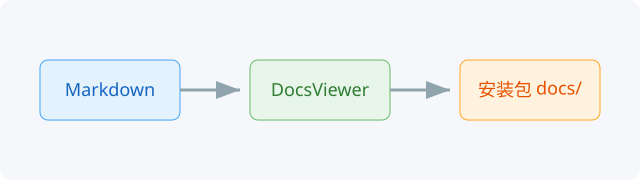

# 快速开始

## 打开文档

在 Ribbon 的“文档”面板点击“应用文档”，或使用菜单中的同名入口。

## 浏览与跳转

- 左侧上方是文档列表，下方是当前文档大纲
- 点击大纲条目会滚动到对应章节
- 内部 Markdown 链接会在查看器中打开目标文档
- 外部链接交给系统默认浏览器

## 搜索与缩放

在顶部搜索框输入关键词，按回车或点击“下一个”；“上一个”反向查找。
缩放按钮和 `MarkdownView` 自带的快捷键都可以调整比例。

## 代码与表格

```cpp
int main(int argc, char** argv) {
  QApplication app(argc, argv);
  return app.exec();
}
```

| 操作 | 快捷键 |
| --- | --- |
| 查找 | `Ctrl+F` |
| 放大 | `Ctrl+=` |
| 缩小 | `Ctrl+-` |
| 复位 | `Ctrl+0` |



返回[文档总览](index.md)，或继续看[常见问题](faq.md)。
